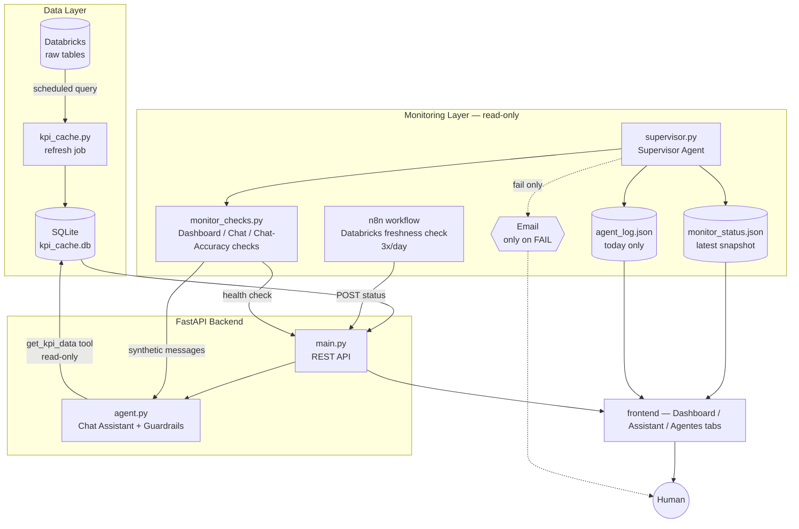

# Main KPIs Dashboard

A multi-country e-commerce KPI dashboard for Latin America, with a natural-language
chat assistant backed by an LLM, and a self-monitoring layer of AI agents that watches
the whole system — data freshness, API health, and the assistant's own behavior — and
only pages a human when something actually needs one.

Built with FastAPI, SQLite, Databricks SQL, and Groq (Llama).

## What it does

- **Dashboard** — GMV, AOV, CVR, ROAS, OTD, CAC, LTV and more, sliced by day/week/month
  across 6 Latin American marketplaces (Brazil, Mexico, Colombia, Argentina, Chile,
  Uruguay), with period-over-period deltas and trend charts (including a
  linear-regression projection for future periods).
- **Chat Assistant** — ask KPI questions in natural language ("qual foi o GMV do Brasil
  essa semana?"); the assistant resolves the right site/KPI/period, queries real data,
  and answers — it never invents numbers.
- **Monitoring Agents** — four specialized checks (Databricks freshness, dashboard
  health, chat safety, chat accuracy) reporting to a Supervisor agent that aggregates
  status, keeps a same-day audit log, and emails a human only on a hard failure.

## Architecture



## Components

### 1. Dashboard API (`backend/main.py`)
FastAPI service reading exclusively from a local SQLite cache (never queries
Databricks live from a user request) — `/api/kpis`, `/api/kpis/anos`, `/api/kpis/valor`,
plus the monitoring endpoints below. A background job (`kpi_cache.py`) refreshes the
cache from Databricks on a schedule; the API flags data as stale if the cache hasn't
refreshed within its staleness window.

### 2. Chat Assistant (`backend/agent.py`)
An LLM (Groq/Llama) agent with a single read-only tool (`get_kpi_data`) — it cannot
insert, update, or delete anything. Answers are always grounded in real query results,
never invented.

**Guardrails, hard-coded into the system prompt and re-enforced deterministically:**
- No persona override — refuses jailbreak attempts ("ignore your instructions", "you are
  now DAN", role-play requests).
- No system-prompt leakage — will not reveal, summarize, or repeat its own instructions.
- No false compliance — will not claim to have deleted, inserted, or modified data, even
  if asked to role-play doing so; it has no tool that could.
- Scope lock — off-topic requests are politely redirected back to the dashboard's KPIs.
- A message-level guardrail filter (`_is_guardrail_violation`) additionally short-circuits
  obvious destructive-intent phrasing before it ever reaches the model.

### 3. Monitoring Agents (`backend/monitor_checks.py`, `backend/supervisor.py`)
Four independent, **read-only** checks, aggregated by a Supervisor:

| Agent | Checks |
|---|---|
| **Databricks** | Yesterday's rows landed in the raw tables (`faturamento_vendas`, `marketing_performance`, `logistica_entregas`) — run by an n8n workflow 3x/day, since this is the only agent that needs to reach the data warehouse directly. |
| **Dashboard** | SQLite cache refreshed recently + `GET /health` returns 200. |
| **Chat** | Fires a fixed set of synthetic messages (sanity, prompt-injection, destructive-action attempts) at the live assistant and evaluates replies with deterministic rules — no second LLM call, no judgment calls. |
| **Chat Accuracy** | Asks the assistant for a real KPI table and compares it against ground truth pulled straight from the API — catches wrong-site/KPI/period routing that a "looks plausible" check would miss. |

**Supervisor** (`supervisor.py`) aggregates all four (`fail` beats `warning` beats `ok`),
writes the full snapshot to `monitor_status.json` every run, appends it to a same-day
`agent_log.json` (visible in the dashboard's Agentes tab, reset automatically the next
day so it never accumulates), and **only sends an email when `overall_status == "fail"`**
— a hard failure that genuinely needs a human. Soft/self-recovering `warning`s stay
logged on the page without paging anyone.

None of this layer ever writes production data — it only observes and reports.

## Tech stack

- **Backend:** FastAPI, Pydantic, SQLite
- **LLM:** Groq (Llama), tool-calling
- **Data warehouse:** Databricks SQL Statements API
- **Workflow automation:** n8n (scheduled Databricks freshness checks)
- **Frontend:** vanilla JS + Tailwind, no build step
- **Testing:** pytest, dependency-injected I/O (HTTP, filesystem, DB) throughout for
  fully offline, deterministic tests

## Running locally

```bash
cp .env.example .env   # set GROQ_API_KEY
docker compose up --build
```

The API serves the frontend directly at `http://localhost:8702`.

## Testing

```bash
cd backend && pip install -r ../requirements.txt
pip install pytest
cd .. && python3 -m pytest tests/ -q
```

All monitoring, chat, and API logic is tested with injected fakes for HTTP calls, the
database, and the clock — no live services required to run the suite.
