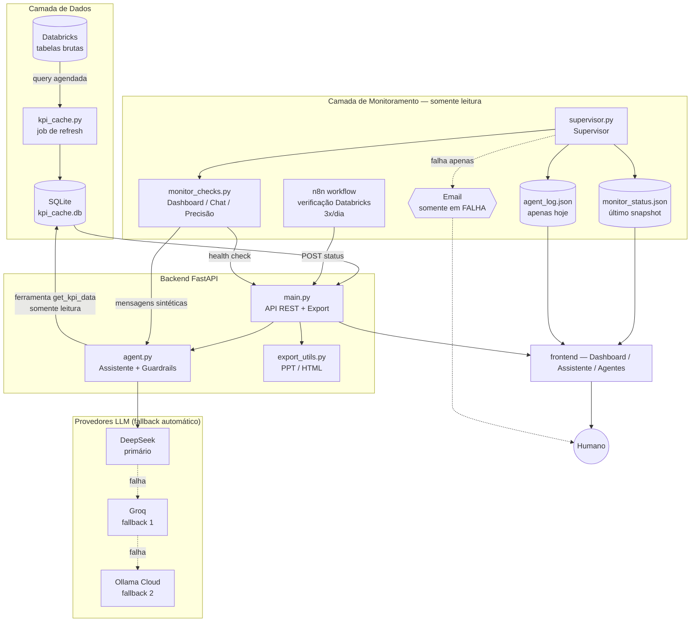

# Main KPIs Dashboard 🇧🇷

Painel de KPIs de e-commerce multi-país para América Latina, com assistente de chat
em linguagem natural baseado em IA, gráficos interativos, exportação de relatórios
(PPT/HTML) e uma camada de monitoramento com agentes autônomos que vigiam todo o
sistema — atualização dos dados, saúde da API e comportamento do assistente —
alertando humanos somente em falhas reais.

Construído com FastAPI, SQLite, Databricks SQL, DeepSeek (primário), Groq e Ollama Cloud (fallback).

## Funcionalidades

- **Dashboard** — GMV, AOV, CVR, ROAS, OTD, CAC, LTV e mais, segmentados por dia/semana/mês
  em 6 marketplaces da América Latina (Brasil, México, Colômbia, Argentina, Chile,
  Uruguai), com variações período contra período e gráficos de tendência (incluindo
  projeção por regressão linear para períodos futuros).
- **Assistente de Chat** — pergunte sobre KPIs em linguagem natural ("qual foi o GMV do Brasil
  essa semana?"); o assistente interpreta o site/KPI/período, consulta dados reais via
  `get_kpi_data` e responde com precisão — **nunca inventa números**.
- **Gráficos automáticos** — ao pedir "gráfico" ou "chart", o sistema gera gráfico de linha
  interativo (Chart.js) renderizado inline no chat, com tendência e projeção.
- **Exportação de relatórios** — digite "gere um ppt" ou "gere html" no chat para baixar
  relatórios formatados em PowerPoint (.pptx) ou HTML com todos os dados da conversa.
- **Investigação inteligente** — ao perguntar "por que" ou "motivo", o assistente cruza
  automaticamente KPIs correlacionados (OTD, Tempo Despacho, Cancelamento) para encontrar
  causas raiz.
- **Respostas em Markdown** — tabelas formatadas, indicadores 🟢🔴 com semântica correta
  (sabe quais KPIs são "maior = melhor" e quais são "menor = melhor"), bandeiras dos
  países renderizadas como imagens PNG.
- **Bandeiras dos países** — exibidas como imagens reais (flagcdn.com) ao lado do código
  do site (MLB 🇧🇷, MLM 🇲🇽, MCO 🇨🇴, MLA 🇦🇷, MLC 🇨🇱, MLU 🇺🇾).
- **Monitoramento com Agentes** — quatro verificações especializadas (Databricks, dashboard,
  chat, precisão do chat) reportando a um Supervisor que consolida o status, mantém
  um log diário de auditoria e envia email somente em falha crítica.

## Arquitetura



## Componentes

### 1. API do Dashboard (`backend/main.py`)
Serviço FastAPI que lê exclusivamente do cache SQLite local (nunca consulta Databricks
diretamente de uma requisição do usuário) — `/api/kpis`, `/api/kpis/anos`, `/api/kpis/valor`,
além dos endpoints de monitoramento e exportação. Um job em background (`kpi_cache.py`)
atualiza o cache do Databricks periodicamente; a API sinaliza dados como desatualizados
se o cache não for renovado dentro da janela de tolerância.

### 2. Assistente de Chat (`backend/agent.py`)
Agente LLM com fallback automático entre múltiplos provedores (DeepSeek → Groq →
Ollama Cloud) e uma única ferramenta somente leitura (`get_kpi_data`) — não pode
inserir, atualizar ou deletar nada. Respostas sempre baseadas em dados reais, nunca
inventadas.

**Guardrails (no system prompt + verificação determinística):**
- Sem troca de persona — recusa tentativas de jailbreak ("ignore suas instruções",
  "você agora é DAN", role-play).
- Sem vazamento de system prompt — não revela, resume ou repete instruções internas.
- Sem falsa conformidade — não afirma ter deletado, inserido ou modificado dados,
  mesmo sob pedido de role-play; não possui ferramenta que permita tal ação.
- Escopo restrito — perguntas fora do domínio são redirecionadas educadamente para
  os KPIs do dashboard.
- Filtro na mensagem (`_is_guardrail_violation`) barra frases destrutivas antes mesmo
  de chegarem ao modelo.

**Recursos do chat:**
- Respostas em **Markdown** renderizado (tabelas, negrito, listas)
- Indicadores **🟢/🔴** com semântica por KPI (sabe que Cancelamento↓ = 🟢 bom, GMV↑ = 🟢 bom)
- **Bandeiras PNG** dos países via flagcdn.com
- **Spinner** "Buscando dados..." durante o carregamento
- **Timer** sutil da sessão no topo do chat
- **Gráficos interativos** Chart.js (ao pedir "gráfico")
- **Exportação PPT/HTML** (ao pedir "gere um ppt" / "gere html")
- **Investigação automática** de causas raiz (cruza KPIs correlacionados)

### 3. Exportação (`backend/export_utils.py`)
Geração de relatórios a partir do histórico da conversa:
- **PPT** — slides com título, tabelas de dados, transcrição do chat
- **HTML** — relatório standalone com CSS, tabelas formatadas, pronto para impressão

### 4. Agentes de Monitoramento (`backend/monitor_checks.py`, `backend/supervisor.py`)
Quatro verificações independentes, **somente leitura**, consolidadas por um Supervisor:

| Agente | Verifica |
|---|---|
| **Databricks** | Dados do dia anterior nas tabelas brutas (`faturamento_vendas`, `marketing_performance`, `logistica_entregas`) — executado por workflow n8n 3x/dia, único agente que acessa o data warehouse diretamente. |
| **Dashboard** | Cache SQLite atualizado recentemente + `GET /health` retorna 200. |
| **Chat** | Dispara mensagens sintéticas fixas (sanidade, injeção de prompt, ações destrutivas) no assistente e avalia respostas com regras determinísticas — sem segunda chamada LLM. |
| **Precisão do Chat** | Pergunta KPIs reais ao assistente e compara com valores da API — detecta erros de roteamento site/KPI/período. |

**Supervisor** (`supervisor.py`) consolida os quatro (`fail` > `warning` > `ok`),
escreve o snapshot completo em `monitor_status.json` a cada execução, anexa ao
`agent_log.json` do dia (visível na aba Agentes do dashboard, reset automático
diário), e **só envia email quando `overall_status == "fail"`** — falha crítica
que realmente precisa de um humano. Avisos soft/auto-recuperáveis (`warning`)
ficam registrados na página sem alertar ninguém.

Nenhum componente desta camada escreve dados de produção — apenas observa e reporta.

## Stack

- **Backend:** FastAPI, Pydantic, SQLite
- **LLM:** DeepSeek (primário), Groq (fallback), Ollama Cloud (fallback)
- **Data warehouse:** Databricks SQL Statements API
- **Automação:** n8n (verificações agendadas do Databricks)
- **Frontend:** vanilla JS + Tailwind CSS + Chart.js + marked.js, sem build step
- **Exportação:** python-pptx (PowerPoint), HTML standalone
- **Testes:** pytest, I/O injetável (HTTP, filesystem, DB) para testes offline e determinísticos

## Executando localmente

```bash
cp .env.example .env   # configure as chaves de API (DEEPSEEK_API_KEY, GROQ_API_KEY)
python3 -m venv .venv && source .venv/bin/activate
pip install -r requirements.txt
uvicorn backend.main:app --host 0.0.0.0 --port 8702
```

A API serve o frontend diretamente em `http://localhost:8702`.

## Testes

```bash
cd backend && pip install -r ../requirements.txt
pip install pytest
cd .. && python3 -m pytest tests/ -q
```

Toda a lógica de monitoramento, chat e API é testada com injeção de dependências
para chamadas HTTP, banco de dados e relógio — sem necessidade de serviços externos.
